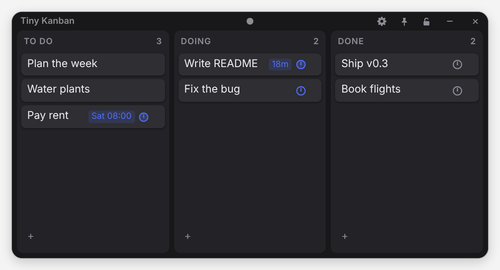
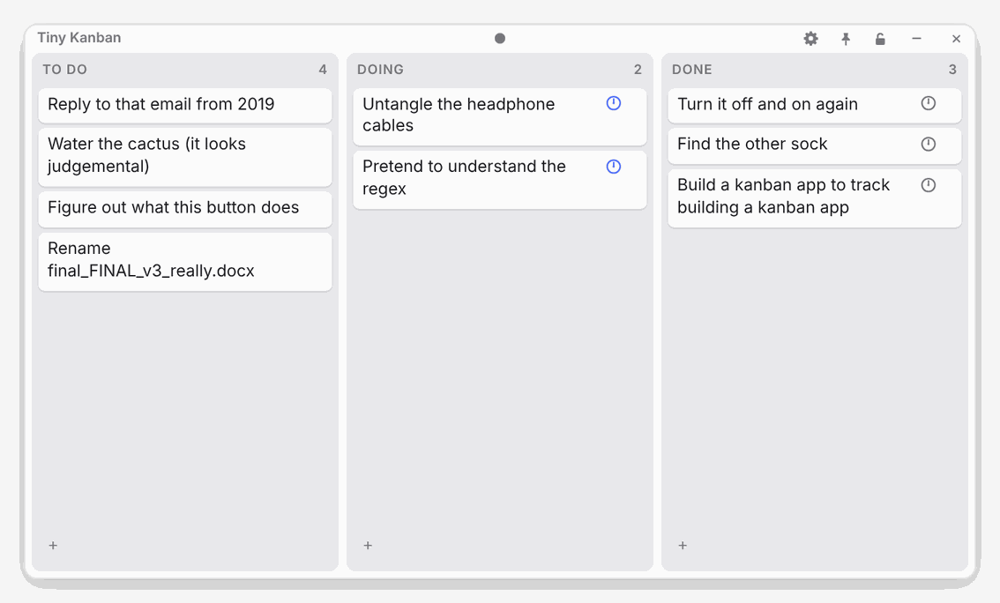
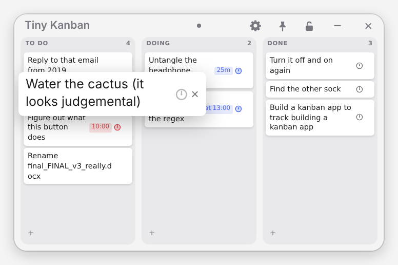
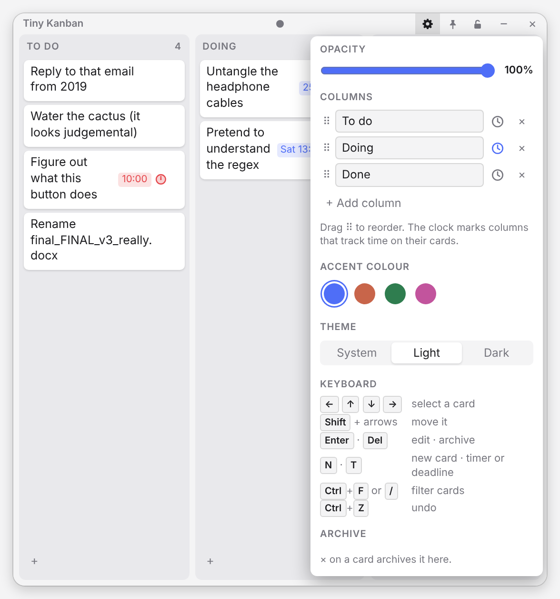
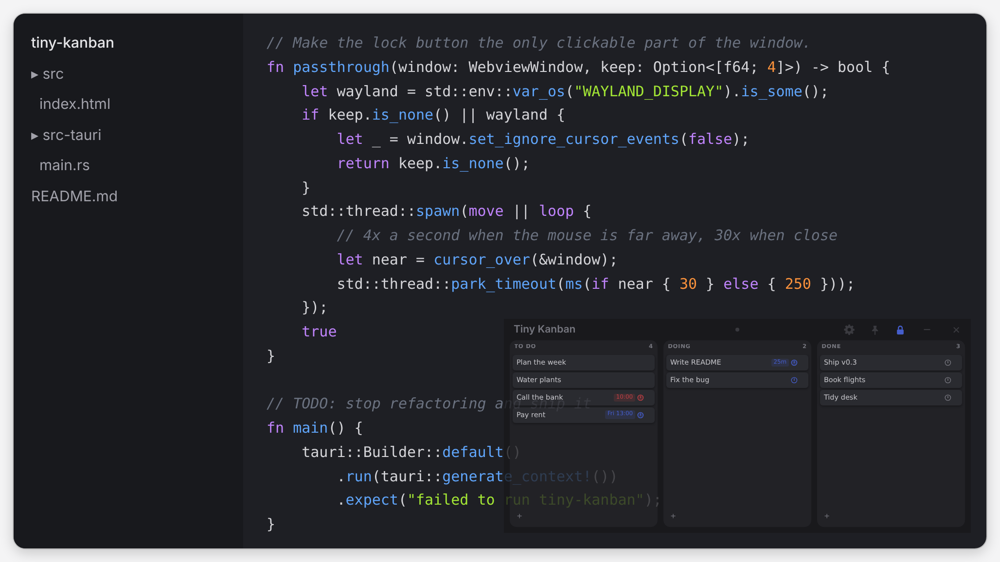

# Tiny Kanban

<p align="center"></p>

A tiny, fast desktop kanban board for Windows, macOS and Linux. One sentence per card, drag between columns,
nothing else in the way. Installers are about 2 MB, because it uses your OS's own web engine instead of bundling a
browser.

## What it's good for

- **A to-do list that sits on top of your work.** Pin it on top, turn the opacity down and lock it: clicks pass
  straight through to the window underneath. It becomes a see-through overlay you glance at, not a window you manage.
- **Seeing where the time went.** Cards in **Doing** get a small ticking clock. Hover it to see how long the card has
  been in progress. The clock pauses while the app is closed or the computer sleeps.
- **Staying small.** Mini mode shrinks the text so a whole board fits in a corner of the screen, and hovering a card
  pops it out at full size.
- **Not being another heavy app.** It runs in efficiency mode while you're not using it. There's no account and no
  cloud: your board is a JSON file on your computer.

## Screenshots

| | |
|:-:|:-:|
|  |  |
| Light mode, with a timer, a deadline and an overdue card | Mini mode: hover a card to read it full size |
|  |  |
| Settings: columns, colours, shortcuts, archive | Locked at 80% opacity over an editor; clicks go through |

## Highlights

- **Cards:** drag and drop, double-click to edit, autocomplete from words already on the board, and the OS's own spell
  check. Web links in cards are clickable. × archives a card; restore it or delete it for good from settings.
- **Keyboard:** arrows select a card, <kbd>Shift</kbd>+arrows move it, <kbd>Enter</kbd> edits, <kbd>Del</kbd> archives,
  <kbd>N</kbd> adds a card, <kbd>T</kbd> sets a timer or deadline, <kbd>Ctrl</kbd>+<kbd>F</kbd> or <kbd>/</kbd> filters the board,
  and <kbd>Ctrl</kbd>+<kbd>Z</kbd> undoes the last change (<kbd>⌘</kbd> on Mac).
- **Columns:** rename, add, remove, drag to reorder, and choose which columns track time.
- **Timers and deadlines:** click a card's clock (or the faint one that appears on hover) and type when: `25` or
  `1h30` starts a timer; `15:00`, `3pm`, `fri`, `tomorrow 9`, `14/11` or `14 nov 17:00` sets a deadline (day names work
  in English and your system language). The card shows the time left or the deadline next to its clock. When it's up
  you get an OS notification, or, where notifications aren't available, a soft ping and the window at full opacity
  for a few seconds. Timers then clear; a passed deadline stays red until you clear it or the card reaches the last
  column. The same popup shows and resets the card's tracked time.
- **Overlay:** always on top, opacity 30–100%, and a lock that passes clicks through to the windows behind. The
  keyboard controls still work while locked, whenever the window has keyboard focus.
- **Shortcuts (system-wide):** <kbd>Ctrl</kbd>+<kbd>Alt</kbd>+<kbd>L</kbd> locks/unlocks, and
  <kbd>Ctrl</kbd>+<kbd>Alt</kbd>+<kbd>M</kbd> brings the window to the mouse and gives it keyboard focus (<kbd>⌘</kbd><kbd>⌥</kbd> on Mac).
  Both can be changed in settings.
- **Looks:** system/light/dark theme and four accent colours. No title bar, just a thin strip to drag.
- **Remembers everything:** board, settings, and window position and size. It can launch at login.
- **Updates itself** from GitHub Releases (signed); an **Update** button appears when there's a new version.

## Install

Download the latest version from [**Releases**](https://github.com/datorkar/tiny-kanban/releases/latest):

| OS | File |
|---|---|
| Windows | `…_x64-setup.exe` (or `.msi`) |
| macOS (Apple Silicon and Intel) | `…_universal.dmg` |
| Debian, Ubuntu, Mint… | `…_amd64.deb` |
| Fedora, RHEL… | `….x86_64.rpm` (doesn't auto-update) |

The installers aren't OS code-signed. On macOS, right-click the app and choose **Open** the first time. On
Windows, choose **More info → Run anyway**. For other Linux distros and Wayland notes, see
[docs/linux.md](docs/linux.md). Deploying it at work? See [docs/it.md](docs/it.md) for silent installs, turning off
self-updates, and what the app does on the machine.

Your board is saved in `board.json`:
- Linux: `~/.local/share/app.tinykanban/`
- macOS: `~/Library/Application Support/app.tinykanban/`
- Windows: `%APPDATA%\app.tinykanban\`

## Building

Built with [Tauri 2](https://tauri.app): a small Rust app around a single dependency-free HTML file.

```bash
npm install
npm run dev
```

Building, CI, releases and update signing are covered in [docs/development.md](docs/development.md).
